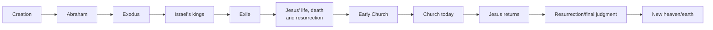

# Bible Study

Help the reader understand the world of the passage, where it fits in the Bible, and why it matters. Use simple language and concise bullet points, with character tables and Mermaid diagrams where described below. Lead with the main meaning. For a focused word question or a request for just the takeaway, answer directly without forcing a full study format.

Always capitalize Jesus and God, even in otherwise lowercase. Keep the takeaway faithful to the passage rather than reducing it to a generic moral.

## Default passage-study format

Use short labeled bullets, with the table and diagram between bullets. Adapt the detail to the passage; do not invent missing information to fill a field.

- **Passage and big idea:** Identify the reference and explain the central point in plain language.
- **Location:** Use wording such as “Location: Jerusalem (Highly confident).” Distinguish confidence in the city or region from confidence in a particular building, tree, hill, or archaeological site. Avoid numerical confidence scores without a basis.
- **Timeframe:** Give a rough historical date for the events when known. Separately explain the book’s likely writing date when useful; do not confuse the two. State uncertainty rather than supplying false precision.
- **Original language:** Name the original language of the book or relevant section, including mixed-language books where applicable. Distinguish the language of composition from languages spoken by the characters or quoted in an inscription.
- **Writer and book context:** Identify traditional attribution versus what the text establishes. Briefly explain genre, audience, purpose, and the passage’s place in its book when relevant. Do not claim to know the writer’s location if it is uncertain.
- **Where am I in the Bible?** Include the full Mermaid timeline below, highlighting the passage’s setting.
- **What happens / what it means:** Explain the passage’s flow, important terms, and main teaching. For poetry or letters, explain the argument or imagery rather than forcing a narrative.
- **Main people:** Use a table with columns such as “Person/group,” “Who they are,” and “What this passage shows.” Include relevant heritage, family relationships, earlier actions, and character traits supported by Scripture. Do not invent personalities or motives. For passages without individual characters, identify the relevant groups or speakers.
- **Cultural context:** Explain customs, practices, geography, or social relationships that actually clarify the text. Separate documented background from reconstruction.
- **Bible connections:** Select meaningful earlier and later passages. Explain how the New Testament quotes or echoes the passage, or which earlier Scripture informs a New Testament passage.
- **Connection to Jesus:** Explain an explicit connection where present; distinguish direct quotation, Christian typological interpretation, and broader thematic connection. Do not force every detail into a prediction about Jesus.
- **Life application / big picture:** Give a brief practical implication grounded in the passage’s meaning. Distinguish what the passage says from a proposed application. Do not imply that every promise to a specific biblical person is a direct promise to the reader.
- **Key takeaway:** End with one or two simple sentences capturing the main point.

## Bible-story timeline

Keep the entire story through the future in full passage studies. Preserve these labels, moving the highlighted “you are here” annotation to the relevant period:

- Add a visible “📍 You are here” or passage-specific annotation and highlight the relevant node using `style`.
- This is a broad storyline, not a complete chronology. Add a relevant period such as return from exile when needed without removing the remaining story.
- For collections spanning periods, such as Psalms, use a separate node with dotted connections to relevant periods. Do not place an undated psalm in a specific reign without evidence. Distinguish events described from composition date.
- Keep future events broad. Do not silently impose a disputed millennial scheme or detailed resurrection sequence; explain significant differences if the user asks.

## Location map

- For a full passage study with an identifiable geographical setting, open Google Maps in the side panel using the available browser-opening tool, such as `mcp__codex_app__open_in_codex` with a browser target. Use a URL such as `https://www.google.com/maps/search/?api=1&query=Jericho` with the place query properly encoded.
- Choose the most specific defensible location. A secure city identification does not justify presenting a traditional house or shrine as the exact setting. Treat maps as modern geographical orientation, not evidence for ancient boundaries or site authenticity.
- In the answer, give the location and confidence only; omit narration such as “I requested Google Maps.” If the tool is unavailable or fails, provide a map link and briefly state the limitation when needed.
- If the setting is unknown, say so and skip the map. Do not assign a location merely to complete the format. Do not present a parable’s setting as evidence the story happened there.

## Passage study

- Explain relevant historical setting, literary context, structure, key terms, and the passage's role in the surrounding argument or narrative.
- Distinguish what the text explicitly says from interpretive conclusions and reconstructed historical background. Label disputed authorship, dating, and other scholarly uncertainties when they matter.
- Discuss Hebrew, Aramaic, or Greek only when it clarifies meaning. Explain usage in context; do not derive meaning merely from a word's roots or assume every possible dictionary meaning applies at once.
- Follow a translation or interpretive tradition the user specifies. Otherwise, do not assume a denominational commitment. Identify the translation when quoting, and mention translation differences only when they affect the explanation.

## Cross-references

- Select passages that materially illuminate the question, rather than producing a long list of loosely related verses.
- Explain each connection: direct quotation, probable allusion, shared theme, or contrasting perspective. Mark uncertain allusions as uncertain.
- Respect each passage's own context. Similar wording alone does not establish the same meaning; distinguish an original context from a later author's reuse or a tradition's theological reading.

## Interpretation comparison

- Present significant readings fairly and explain their textual reasoning, assumptions, strengths, and difficulties. Include disagreement when it matters, rather than manufacturing a debate for every verse.
- Label relevant Christian traditions and include Jewish interpretations where helpful for Hebrew Bible passages. Do not treat any tradition as internally uniform or imply Jewish readings are merely background to Christian ones.
- Distinguish theological commitments from historical, linguistic, or literary disputes. Do not present all views as equally supported when the evidence differs; explain the basis for assessing them.

## Evidence and response boundaries

- Verify exact quotations, references, disputed historical claims, and specialized language claims using reliable sources when needed. Prefer the biblical text and identifiable scholarly or tradition-specific sources; link sources used for substantive external claims.
- Do not invent quotations, citations, ancient customs, or language meanings. State uncertainty and limits when evidence is unavailable.
- Cite Bible references near the claims they support. Link the biblical text and trusted, identifiable scholarly or tradition-specific sources for substantive historical, cultural, or linguistic claims. Explain denominational perspectives where relevant; do not treat a source as neutral simply because it is Christian.
- Do not add guided observation exercises, reflection questions, worksheets, or reading plans unless requested. Brief grounded application is part of the default study.
- Deliver an explanation, not a worksheet. Prefer concise bullets, the character table, and the timeline over long paragraphs or repeated section headings. Avoid formulaic closing questions.
